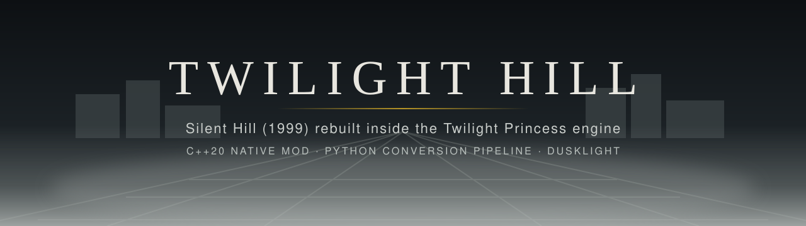
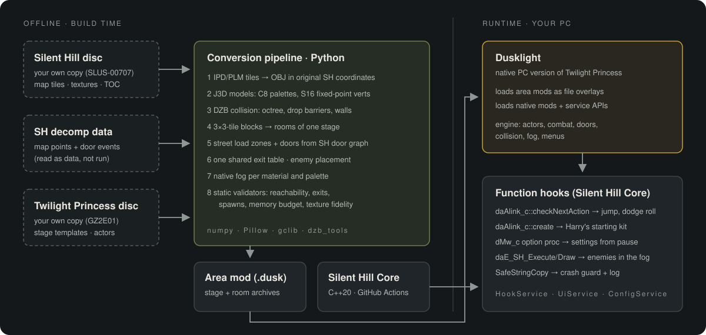
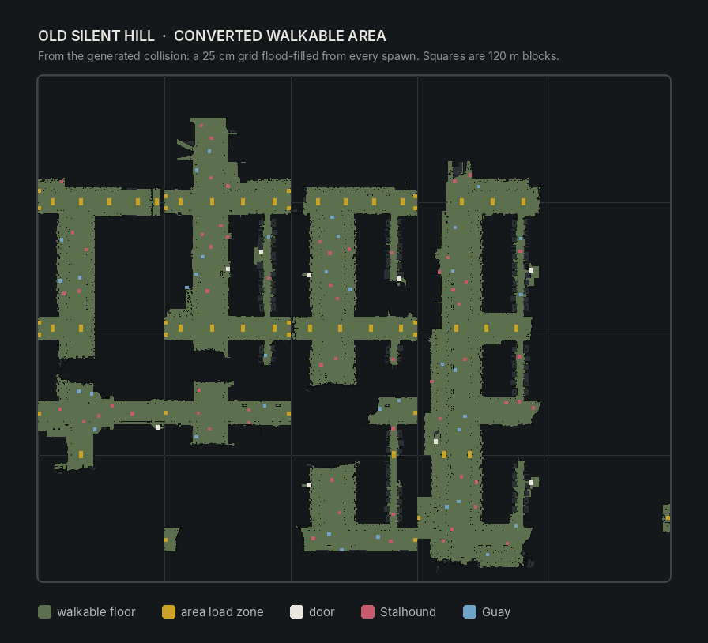
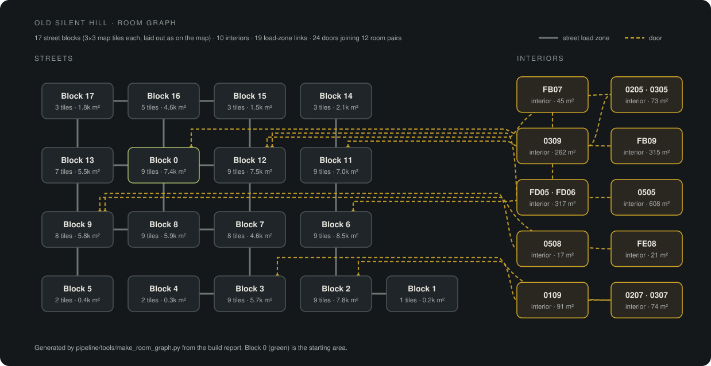

<p align="center">
  
</p>

<p align="center">
  <a href="https://github.com/commonvtake/twilight-hill-1/actions/workflows/build.yml"></a>
  
  
  
  
  
</p>

**Twilight Hill** is a total-conversion mod that rebuilds the town of *Silent Hill* (PlayStation, 1999)
inside the engine of *The Legend of Zelda: Twilight Princess* (GameCube, 2006), running on
[Dusklight](https://github.com/TwilitRealm/dusk), the native PC version of Twilight Princess.

Silent Hill's original map data is converted offline into Twilight Princess stage, model and
collision files, and a native C++ mod hooks the game at runtime to add the controls, gear and
systems the crossover needs. You walk Old Silent Hill's foggy streets as Link, enter its buildings
through working doors, and fight its creatures with Twilight Princess combat.

> **Status:** playable prototype (0.8.0), about 22% of the full campaign. See [PROGRESS.md](PROGRESS.md).
> You need your own legally obtained copies of both games. No game files are included in this repository.

---

## Highlights

| Feature | Details |
|---|---|
| **The whole Old Silent Hill map** | 115 original map tiles converted into 17 street areas of one Twilight Princess stage, joined by seamless load zones |
| **Buildings with working doors** | 10 interiors behind 24 knob doors, wired from Silent Hill's own door data (map points + `LoadRoom` events) |
| **Twilight Princess combat** | Sword, shield, side hops, backflips and jump attacks; Stalhounds and Guays stand in for Groaners and Air Screamers |
| **New controls** | Jump button with a tunable height, a directional dodge roll, settings menu from the pause screen |
| **Fidelity checks** | Paletted textures verified pixel-identical; geometry error under 1.3 mm; every exit, spawn and door validated |

## How it works

<p align="center"></p>

Neither game's code is merged. Only Twilight Princess runs. Silent Hill contributes its map
geometry, textures and door layout, rebuilt as Twilight Princess data; all gameplay runs on
Twilight Princess's own engine systems (actors, collision, doors, combat, fog).

### Conversion pipeline (Python, `pipeline/tools`)

1. **Extract.** Reads Silent Hill's packed archive through the executable's file table and unpacks
   the 128 town map tiles (`.IPD`) with their textures.
2. **Models.** Builds J3D (`.bmd`) models in Silent Hill's original world coordinates. Textures
   are re-encoded as 8-bit paletted C8/RGB5A3 and positions as 16-bit fixed point, which halves
   memory while staying pixel-identical to the previous format (checked by a validator).
3. **Collision.** Generates `.dzb` collision with an octree, perimeter walls and **automatic drop
   barriers**: walkable floor is rasterised on a 25 cm grid, flood-filled from every spawn, and any
   reachable edge that falls into empty space gets an invisible wall.
4. **Streaming.** Splits the town into 3×3-tile blocks, one per room, so only one block (≤ 3 MB) is
   in the engine's memory budget at a time. Load zones are placed wherever the street continues
   across a block edge.
5. **Doors.** Parses Silent Hill's door events from the SH decompilation's map data, raycasts the
   collision mesh to find the wall each door faces, and places a native knob door with a supported
   crossing behind it and an arrival point clear of the doorway.
6. **Exits.** Writes one shared exit table for the stage and every room (see *Debugging story*).
7. **Validation.** Static checks before anything ships: every trigger → exit → room → spawn
   resolves, arrivals stand on reachable floor outside any trigger, the room graph is connected
   and two-way, archives fit the memory budget.

### Silent Hill Core (C++20 native mod, `src/mod.cpp`)

| Hooked function | Behaviour |
|---|---|
| `daAlink_c::checkNextAction` | Jump button (fixed apex height, keeps ground speed) and RB dodge roll in the stick direction |
| `daAlink_c::create` | Harry's starting gear as Zelda items: Lantern, Hero's Bow, Red Potions, sword, shield, 5 hearts |
| `dMw_c::collect_option_open_proc` | *Options* on the pause screen opens Dusklight's display, graphics, audio and control settings |
| `daE_SH_Execute` / `daE_SH_Draw` | Night-only Stalhounds see midnight inside the Silent Hill areas, so they rise in the fog |
| `SafeStringCopy` | Crash guard: truncates and logs instead of aborting (diagnostics for playtests) |

Built with CMake/Ninja against the Dusklight mod SDK (HookService, UiService, ConfigService).
GitHub Actions compiles it for Windows, Linux, macOS, iOS and Android and publishes a
`latest-build` release on every push.

### Debugging story: the shared exit table

Playtests of 0.7.0 aborted with `Destination buffer too small!` after walking
between areas. Reading the engine source showed why: while Link is between rooms (mid door
animation, mid-air) his room number is −1, and `dStage_changeScene` then looks the exit up in the
**stage's** table instead of the room's. The stage table had one entry, so any exit index above 0
read past its end and fed a garbage stage name to the next scene. The fix was structural: a single
global exit table copied into the stage and every room, so an exit index means the same thing
everywhere. A second playtest issue (no sword or shield) traced to the stage type inherited from
an indoor template (`ST_ROOM`), which makes `checkNotBattleStage()` true; areas are now `ST_FIELD`.

## Map

<p align="center"></p>
<p align="center"><sub>Plotted by the validator from the generated collision data, not a screenshot.</sub></p>

<p align="center"></p>

<!-- Gameplay screenshots: put PNGs in docs/screenshots/ and list them here, e.g.
<p align="center"> </p>
-->

## Tech stack

| Area | Tools |
|---|---|
| Native mod | C++20, CMake, Ninja, Clang/MSVC, Dusklight mod SDK, fmt |
| Pipeline | Python 3, NumPy, Pillow, gclib (J3D/RARC), blender_dzb_tools (DZB), sh_ipd2obj |
| Formats | Silent Hill IPD/PLM/TIM; GameCube J3D BMD, DZB collision, DZR/DZS stage data, RARC archives |
| Engine knowledge | zeldaret/tp decompilation, Silent Hill decompilation (map points and events) |
| CI/CD | GitHub Actions matrix (8 targets), bundle merge, automatic prerelease |

## Play it

**Requirements:** Windows 10/11, your own *Twilight Princess* (GameCube, USA `GZ2E01`) disc image
and your own *Silent Hill* (PlayStation, USA 1.1 `SLUS-00707`) disc.

1. Download `silent_hill_core.dusk` from the [latest-build release](../../releases/tag/latest-build).
2. Build the area mod from your own Silent Hill disc with the pipeline (see below). It produces
   `OldTownMods/SilentHillOldTown.dusk`.
3. Run `pipeline/Launch-Silent-Hill.cmd`. On first run it downloads the official Dusklight 2.0.3
   runtime and asks for your Twilight Princess disc image.

| Action | Xbox controller |
|---|---|
| Jump | LB (keyboard: Space) |
| Dodge roll | RB, in the stick direction |
| Sword · shield · lock on | X · right trigger · left trigger |
| Open door | A |
| Lantern · bow · item ring | B · Y · D-pad |
| Pause / settings | Start → Options |

Keyboard and other controllers follow Dusklight's own bindings, which can be changed in its menu.

## Build from source

```sh
# Native mod
cmake -B build -G Ninja && cmake --build build      # → build/mods/silent_hill_core.dusk

# Area mod (needs your discs extracted; see pipeline/CHECKPOINT.md for the layout)
python pipeline/tools/export_cafe.py           # builds the Silent Hill map exporter
SH_DECOMP=path/to/silent-hill-decomp \
python pipeline/tools/build_oldtown.py         # streets, interiors, doors, enemies
python pipeline/tools/package_town_stage.py    # → OldTownMods/SilentHillOldTown.dusk
python pipeline/tools/validate_town_stage.py   # static checks + map image
python pipeline/tools/make_room_graph.py       # room/door graph SVG
```

## Roadmap

- Story start: Cafe 5to2 items, the opening alley and the Otherworld
- Midwich Elementary School as the first dungeon
- Silent Hill creature models and AI in place of the Zelda stand-ins
- Save points, puzzles and progression flags from the decompiled event data

## Credits

- [Dusklight](https://github.com/TwilitRealm/dusk) by Twilit Realm, and the
  [zeldaret/tp](https://github.com/zeldaret/tp) decompilation
- [Silent Hill decompilation](https://github.com/shdecompilations/silent-hill-decomp), used as a
  reference for file formats and map data only
- [sh_ipd2obj](https://github.com/belek666/sh_ipd2obj) by belek666,
  [gclib](https://github.com/LagoLunatic/gclib) and
  [blender_dzb_tools](https://github.com/LagoLunatic/blender_dzb_tools) by LagoLunatic

## Legal

A non-commercial fan project. *The Legend of Zelda* and *Twilight Princess* are trademarks of
Nintendo; *Silent Hill* is a trademark of Konami. This project is not affiliated with or endorsed
by either company. The repository contains only original code and documentation; all game data
is read from discs you own, at build time and at runtime.
